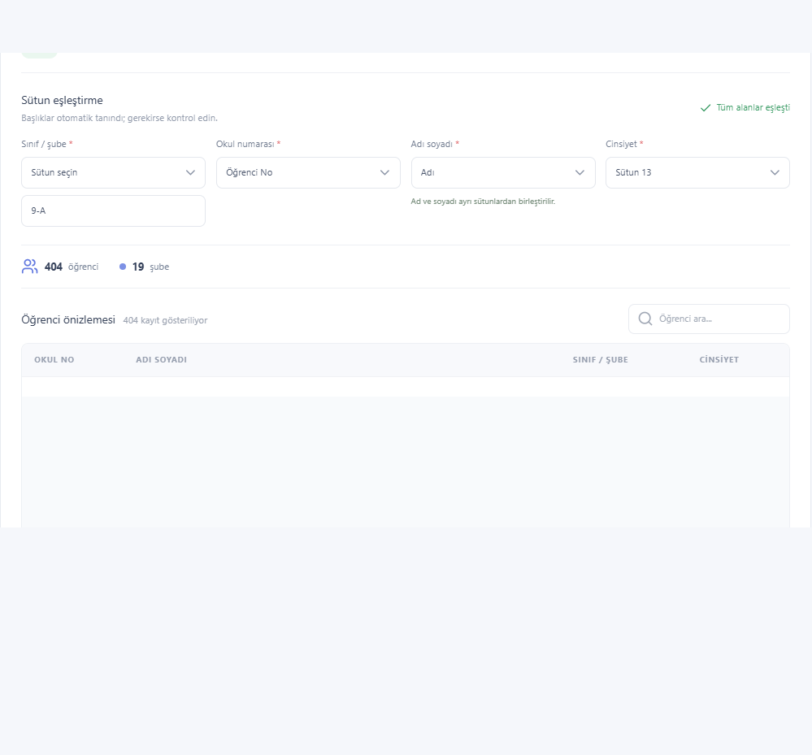
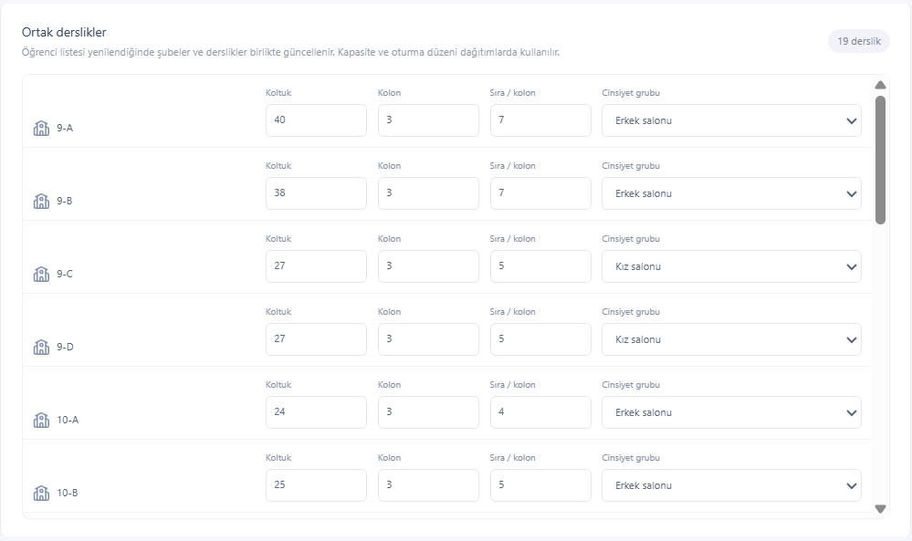
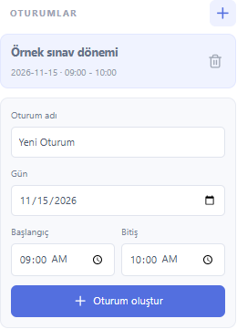
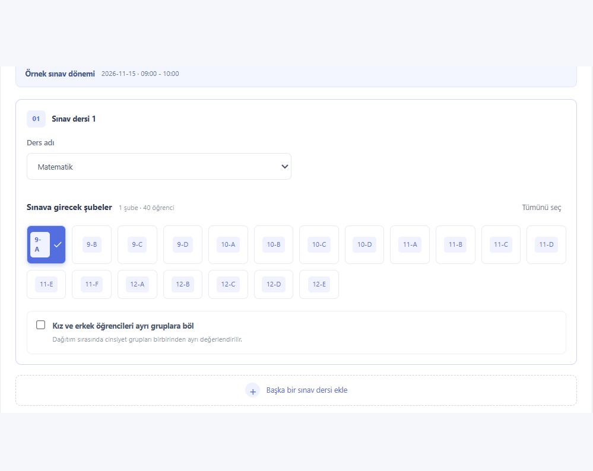
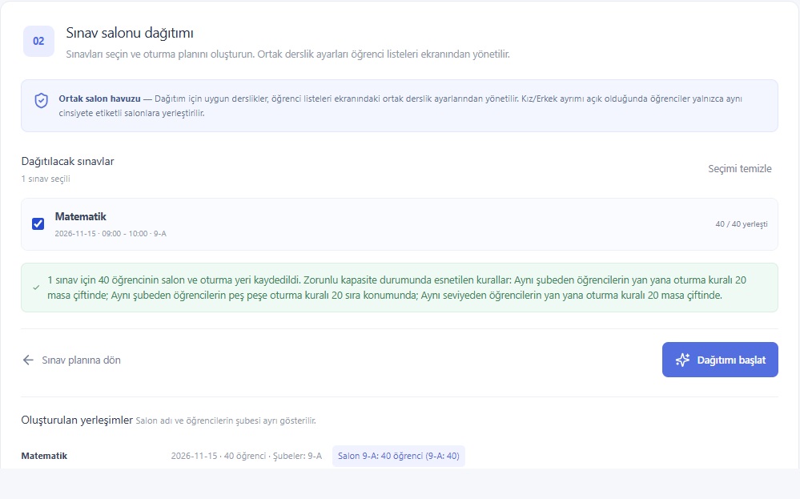
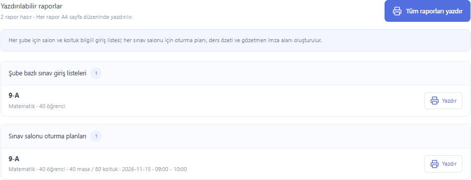

# Sınavcı

Liseler için yerel sınav planlama, kelebek salon dağıtımı ve raporlama uygulaması. Öğrenci, derslik, sınav ve yerleşim verileri tarayıcının yerel veritabanında saklanır; uygulama bir sunucuya öğrenci verisi göndermez.

## Demo

[Sınavcı demosunu açın](https://sinavci.teknovip.net/)

## Başlarken

```bash
npm install
npm run dev
```

Üretim derlemesini kontrol etmek için:

```bash
npm run build
```

Çalışan geliştirme sunucusunu durdurup projeyi yeniden derlemek ve başlatmak için:

```bash
bash restart.sh
```

Betik uygulamayı `http://127.0.0.1:5173/` adresinde başlatır; çıktıları proje dizinindeki `dev.log` dosyasına yazar.

Uygulamayı kullanırken sınav planlama, dağıtım ve raporlar için önce bir oturum seçin. Öğrenci ve derslik listeleri oturumlardan bağımsız, cihazdaki ortak verilerdir.

## 1. Öğrenci listesini içe aktarma

1. Sol menüden **Öğrenci listeleri** bölümünü açın.
2. e-Okul’dan alınan `.XLS` veya `.XLSX` dosyasını bırakın ya da dosya seçiciden seçin.
3. Birden fazla çalışma sayfası varsa her sayfayı ve toplam öğrenci önizlemesini kontrol edin.
4. Sistem sınıf/şube, okul numarası, ad-soyad ve cinsiyet alanlarını eşleştirmeye çalışır. Eşleşme doğru değilse **Sütun eşleştirme** alanlarından düzeltin. Ad ve soyad ayrı sütunlardaysa her iki sütunu da kontrol edin.
5. Hatalı veya tekrarlanan kayıtları inceleyin; aktarılacak öğrenci sayısı ve şube sayısı doğruysa **öğrenciyi içe aktar** düğmesine basın.

Aktarım sırasında her şube için otomatik bir derslik oluşturulur:

- Derslik adı şube adı olur (ör. `9-A`).
- Başlangıç kapasitesi o şubedeki öğrenci sayısıdır.
- Kolon sayısı varsayılan olarak 3’tür. Sıra sayısı kapasiteye yetecek şekilde hesaplanır; her sırada iki koltuk bulunur.
- Şubedeki tüm öğrencilerin cinsiyeti aynıysa dersliğe Kız, Erkek veya Belirtilmemiş etiketi verilir. Cinsiyetler karışık ya da belirsizse Karma seçilir.
- Kapasite, kolon, sıra ve cinsiyet grubu öğrenci listeleri ekranındaki **Ortak derslikler** bölümünden düzenlenebilir. Öğrenci listesi yeniden aktarılırken kapasite ve cinsiyet yeniden hesaplanır; mevcut kolon/sıra düzeni korunup gerekirse büyütülür.

İlk 12 satırdaki okul/kurum adı metni de tanınmaya çalışılır ve raporlarda kullanılmak üzere kaydedilir. Bulunamazsa kurum adını **Ayarlar** bölümünden girebilirsiniz.





## 2. Sınav oturumu oluşturma

1. Sol menüdeki **Oturumlar** başlığının yanındaki `+` düğmesine basın.
2. Oturum adını, sınav gününü, başlangıç ve bitiş saatini girin.
3. **Oturum oluştur** ile kaydedin. Oturum listesinde seçerek o oturumun sınav planına geçin.

Her oturumun sınavları ve yerleşimleri birbirinden ayrıdır. Öğrenci ve derslik listeleri ise tüm oturumlarda ortaktır. Oturumu silmek, ona bağlı sınavları ve yerleşimleri de siler.



## 3. Ders ve şube tanımlama

1. Oturumu seçtikten sonra **Sınavları planla** adımını açın.
2. Ders listesinden bir ders seçin. Listede yoksa **Diğer** seçeneğiyle özel ders adını girin.
3. Sınava girecek şubeleri seçin. Bir sınav kartına birden fazla şube ekleyebilirsiniz.
4. Aynı oturumda başka bir ders sınavı planlamak için **Başka bir sınav dersi ekle** düğmesini kullanın. Bir şube aynı oturumda birden fazla sınava atanamaz.
5. İhtiyaç varsa **Kız ve erkek öğrencileri ayrı gruplara böl** seçeneğini etkinleştirin. Tüm ders kartlarını **Tüm sınavları kaydet** ile kaydedin.



## 4. Dağıtım kuralları ve dağıtımı başlatma

1. **Dağıtımı oluştur** adımında dağıtılacak sınavları işaretleyin. Birlikte seçilen sınavlar ortak salon havuzunu kullanır.
2. **Dağıtımı başlat** düğmesine basın. Sonuçta her öğrenci için salon, kolon/grup, sıra ve sol/sağ koltuk kaydedilir.

Dağıtım, seçilen sınavlardaki şubelerin dersliklerini ortak salon havuzu olarak kullanır. Bir salonda kullanılabilir koltuk sayısı, tanımlı kapasite ile kolon × sıra × 2 değerlerinin küçüğüdür. Kapasite veya cinsiyet etiketi uygun değilse sistem dağıtımı tamamlayamaz; derslik ayarlarını kontrol edip yeniden deneyin.

Oturma planı oluşturulurken sistem:

- Aynı şubeden öğrencileri yan yana ve arka arkaya oturtmamaya,
- Farklı seviyeleri yan yana/arka arkaya getirmeye,
- Şubeleri salonlara dengeli yaymaya çalışır.

Koltuk kapasitesinin zorladığı durumlarda bu oturma tercihleri esnetilebilir; uygulama hangi kuralların kaç konumda esnetildiğini sonuç mesajında gösterir. **Cinsiyet ayrımı etkinse** öğrenciler yalnızca aynı cinsiyet etiketi taşıyan salonlara yerleştirilir; “Belirtilmemiş” öğrenciler için de uygun salon etiketi gerekir. Bir öğrencinin aynı oturumda birden fazla sınava atanması dağıtımı engeller.



## 5. Raporları alma

Dağıtım tamamlandıktan sonra **Raporları yazdır** adımına geçin. Uygulama iki rapor türü hazırlar:

- **Şube bazlı sınav giriş listesi:** Öğrencinin okul numarası ve adı, sınava gireceği salon ve koltuk konumu.
- **Salon oturma planı:** Salon için ders/sınav özeti ve oturma şeması. İkinci sayfada salondaki öğrencilerin imza çizelgesi bulunur.

Tek bir şubenin veya salonun yanındaki **Yazdır** düğmesini kullanabilir ya da **Tüm raporları yazdır** ile hepsini topluca yazdırabilirsiniz. Tarayıcının yazdırma penceresinde A4 ve yazıcı ya da PDF hedefini seçin.



## Yedekleme ve kurum ayarları

**Ayarlar** bölümünde kurum adını düzenleyebilir, tüm veritabanını `sinav_yedek.json` olarak dışa aktarabilir veya başka bilgisayarda içe aktarabilirsiniz. İçe aktarma, hedef bilgisayardaki mevcut öğrenci, derslik, oturum, sınav ve yerleşim verilerinin yerine geçer; işlemden önce onay ister.

Yedek dosyasını bilgisayarlar arasında güvenli biçimde taşıyın. Tarayıcı verileri cihaza ve tarayıcı profiline özeldir; tarayıcı verisini temizlemek yerel kayıtları silebilir. **Tüm datayı temizle** işlemi geri alınamaz.
